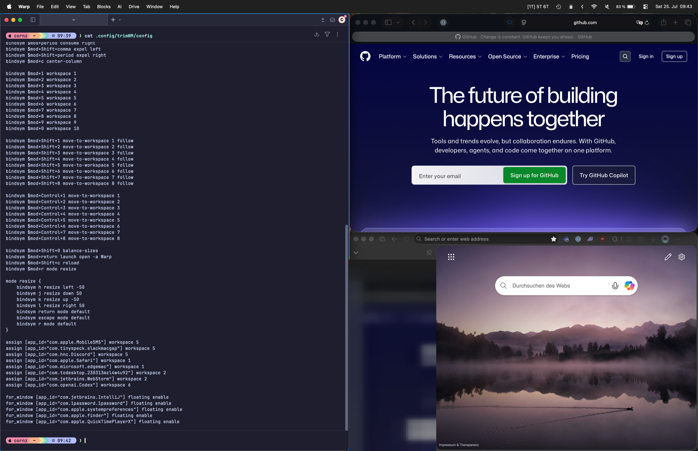
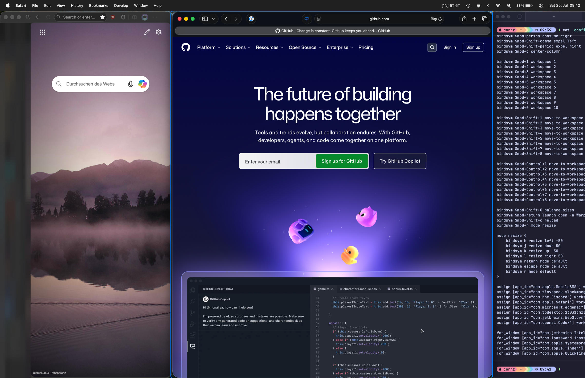
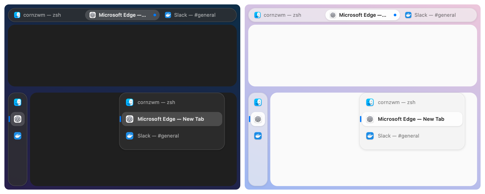
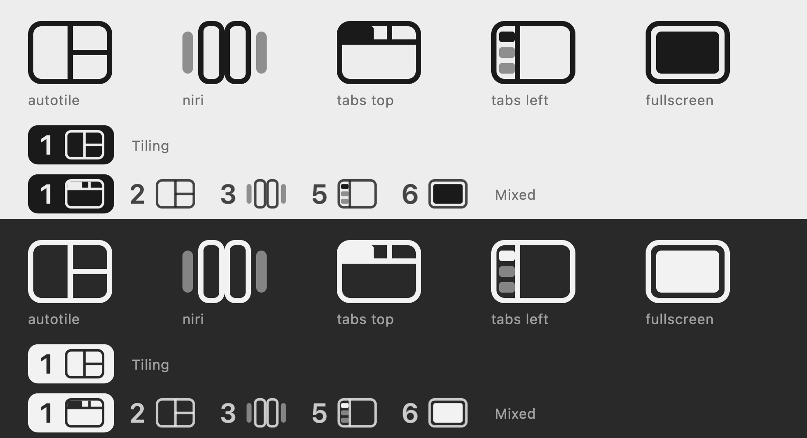

# TrimWM

A fast, animation-free tiling window manager for macOS with i3-style BSP
autotiling, Niri-style scrolling columns, and browser-style tabs.

```sh
brew install --cask cornz/tap/trimwm
```

## Three layouts

Each workspace uses one of three layouts and can switch at any time.

**BSP autotiling** (`Option+Shift+E`): every new window splits the focused one,
i3-style.



**Scrolling columns** (`Option+W`): windows sit in Niri-style columns on a
strip that scrolls sideways.



**Tabs** (`Option+T`): every window shares one frame like tabs in a browser. A
Liquid Glass tab bar sits at the top or as an icon rail on the left that
expands on hover.



The menu bar lists each occupied workspace with a glyph for its layout:



## Quick start

Open TrimWM and grant Accessibility when asked. Windows tile as they open.

- `Option+J/K/L/;`: Focus left, down, up, or right.
- `Option+1…9/0`: Switch to workspace 1…10.
- `Option+W` / `Option+T` / `Option+Shift+E`: Switch the workspace to scrolling columns, tabs, or back to BSP.

Learn more:

- [Configuration](docs/configuration.md)
- [Details](docs/details.md): manual install, building, recovery, and development

Apple Silicon and macOS 26 or later. MIT licensed.
